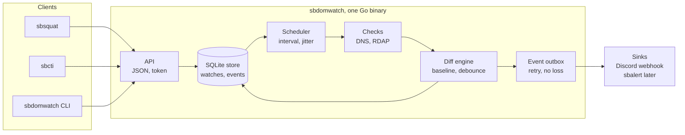

# sbdomwatch: plan, architecture and Claude Code prompt

2026-11-23

## Overview

sbdomwatch (shell alias `sbdw`) is a standalone domain and DNS watcher: you add a domain with a mandatory reason, it records a baseline, and from then on it reports every meaningful change as an event. It is the foundation for the rest of the family: sbsquat (typosquat detection), sbcti and other tools add domains to it, and sbalert delivers the notifications.

**v1 scope**

- Curated watch list in SQLite, added through API and CLI, never from public feeds
- Every watch has a required `reason` and one or more origins (manual, typosquat, incident, intel)
- Lifecycle: new, baselining, active, paused, archived; a `baseline_complete` event carries the first inventory
- Checks: DNS (A, AAAA, CNAME, MX, NS, TXT, CAA, SOA) and RDAP (registered, status, registrar, nameservers, dates), using domping
- Change events with debounce, set-based comparison and volatile-field detection
- Notifications through a generic webhook (Discord first), extracted to sbalert later
- One Go binary: `sbdomwatch serve` runs the service, other subcommands are the CLI; Docker Compose with one container and a volume

**Not in v1**

HTTP and TLS checks, screenshots, web UI, suggestion queue for pivots, AI analyzer, scoring, public feeds, multi-user accounts.

**Naming**

`sb` is both suspiciousbytes and the author's initials. Family: sbdomwatch (watcher), sbsquat (typosquat detector), sbalert (alerting), sbcti (CTI briefs). Module path: `github.com/sbroekhoven/sbdomwatch`.

## Architecture

sbdomwatch is one Go binary with a scheduler, a pluggable check layer and a SQLite store; every other tool in the family talks to it over HTTP.



Clients create watches through the API. The scheduler runs due checks, the diff engine compares each result with the baseline and stores observations, and changes become events in the outbox that are delivered to the sinks.

- **Scheduler:** picks watches whose `next_check_at` has passed, adaptive interval with jitter, per-upstream rate limits (RDAP per registry, DNS per resolver).
- **Checks:** a small interface, `Check{Name(); Run(ctx, domain) (Observation, error)}`. v1 has DNS and RDAP; RDAP wraps the existing domping library.
- **Diff engine:** compares sets, not lists; ignores TTL and ordering; learns volatile fields during baselining; needs 2 to 3 consecutive observations before it emits a change.
- **Event outbox:** events are written to SQLite first and delivered to sinks afterwards, with retries, so nothing is lost when Discord or sbalert is down.
- **API:** JSON over HTTP with token auth. The CLI is the same binary and only talks to this API.
- **Clients:** sbsquat, sbcti and manual use add watches, always with a reason; sbalert later subscribes to events.

**Package layout**

```
cmd/sbdomwatch/     main and cobra subcommands (serve, add, ls, history, events, ...)
internal/config/    config file and env
internal/store/     SQLite, embedded SQL migrations
internal/watch/     lifecycle states, baseline logic
internal/check/     Check interface, dns/, rdap/ (wraps domping)
internal/diff/      set comparison, volatile fields, debounce
internal/sched/     due-watch loop, rate limiters
internal/events/    outbox, sinks (webhook, discord)
internal/api/       handlers, auth, openapi.yaml
internal/client/    API client used by the CLI
```

**Tech choices**

- Go, `modernc.org/sqlite` (no cgo, easy Docker image), `miekg/dns`, `spf13/cobra`, `log/slog`
- domping as a library behind the Check interface; inspect its repo first and adapt, do not copy its code
- `golang.org/x/net/idna` and `publicsuffix` for domain normalization
- `go.yaml.in/yaml/v3` for YAML (the maintained successor of the archived `gopkg.in/yaml.v3`)

## Data model

SQLite with embedded migrations. Times are UTC RFC3339 text. Domains are stored normalized: lowercase, punycode, no trailing dot. Rejected: IP literals, URLs, single-label names, special-use and private TLDs (`localhost`, `local`, `test`, `internal`, `lan`, `home.arpa`, `onion`, ...), unknown TLDs and names that are themselves a public suffix. Subdomains such as `mail.example.com` are accepted and kept as given.

```sql
CREATE TABLE watches (
  id                    INTEGER PRIMARY KEY,
  domain                TEXT NOT NULL UNIQUE,
  template              TEXT NOT NULL,   -- owned | candidate | third-party
  state                 TEXT NOT NULL,   -- new | baselining | active | paused | archived
  interval_sec          INTEGER NOT NULL,
  next_check_at         TEXT NOT NULL,
  baseline_started_at   TEXT,
  baseline_completed_at TEXT,
  volatile_fields       TEXT NOT NULL DEFAULT '[]',  -- JSON list of field paths to ignore
  tags                  TEXT NOT NULL DEFAULT '{}',  -- JSON map, e.g. {"profile":"degiro"}
  expires_at            TEXT,            -- candidates only
  created_at            TEXT NOT NULL,
  updated_at            TEXT NOT NULL
);

CREATE TABLE watch_origins (
  watch_id  INTEGER NOT NULL REFERENCES watches(id),
  origin    TEXT NOT NULL,               -- manual | typosquat | incident | intel
  reason    TEXT NOT NULL CHECK (length(reason) > 0),
  reference TEXT,                        -- ticket, incident, mail reference
  added_by  TEXT NOT NULL,
  added_at  TEXT NOT NULL,
  PRIMARY KEY (watch_id, origin, reason)
);

CREATE TABLE observations (
  id          INTEGER PRIMARY KEY,
  watch_id    INTEGER NOT NULL REFERENCES watches(id),
  check_name  TEXT NOT NULL,             -- dns | rdap
  observed_at TEXT NOT NULL,
  is_baseline INTEGER NOT NULL DEFAULT 0,
  data        TEXT NOT NULL,             -- canonical JSON
  hash        TEXT NOT NULL
);

CREATE TABLE events (
  id          INTEGER PRIMARY KEY,
  watch_id    INTEGER NOT NULL REFERENCES watches(id),
  type        TEXT NOT NULL,
  severity    TEXT NOT NULL,
  occurred_at TEXT NOT NULL,
  payload     TEXT NOT NULL              -- JSON: origins, reason, diff
);

CREATE TABLE event_deliveries (          -- the outbox, one row per event and sink
  event_id     INTEGER NOT NULL REFERENCES events(id),
  sink         TEXT NOT NULL,
  delivered_at TEXT,
  attempts     INTEGER NOT NULL DEFAULT 0,
  last_error   TEXT,
  PRIMARY KEY (event_id, sink)
);

CREATE TABLE audit_log (
  id INTEGER PRIMARY KEY, at TEXT NOT NULL, actor TEXT NOT NULL,
  action TEXT NOT NULL, watch_id INTEGER, detail TEXT
);
```

**Lifecycle**

1. `new`: just added, `next_check_at` is now.
2. `baselining`: 3 observations a few minutes apart, no change events, volatile fields learned. When done, one `baseline_complete` event carries the full inventory and the watch becomes `active`.
3. `active`: every difference from the baseline becomes an event.
4. `paused` and `archived`: no checks. Candidates expire to `archived` after 90 days without a notable change; manual watches never expire.

A domain that is not registered baselines after a single observation, and its first registration fires `registered` immediately.

**Event types**

| Type | When | Default severity |
| --- | --- | --- |
| `baseline_complete` | baseline finished, payload is the inventory | info |
| `registered` | RDAP now shows the domain as registered | high |
| `dropped` | domain is no longer registered | medium |
| `mx_appeared` | MX records added, domain can now handle mail | high |
| `ns_changed` | nameserver set changed | high, critical for owned |
| `registrar_changed` | registrar changed in RDAP | high |
| `record_added`, `record_changed`, `record_removed` | any other DNS difference | medium |
| `expiring` | owned domain close to its expiry date | medium |
| `dangling_cname` | CNAME target no longer resolves | high for owned |

## API and CLI

The API is JSON over HTTP under `/v1` with a bearer token (`SBDOMWATCH_TOKEN`, at least 32 characters; `serve` refuses to start without it). Adding a watch is an idempotent upsert: the same domain twice merges tags and origins instead of creating a duplicate. A `reason` is required on every add.

- **Merge rules:** an origin is added unless the same origin kind with the same reason exists; tags merge with new values winning; the template only moves up (candidate, third-party, owned); a re-added archived watch starts over as `new`; a paused watch stays paused. A candidate's `expires_at` is refreshed by a new origin.
- **Actor:** the `X-Actor` header names who makes a change (`added_by` and the audit log); the CLI sends `$USER`, the default is `api`.
- **Bulk:** at most 1000 watches per request, all or nothing.
- **Errors:** `{"error": {"code", "message", "fields": [{"field", "message"}]}}`.

| Method and path | Purpose |
| --- | --- |
| `POST /v1/watches` | add or merge a watch: `domain`, `template`, `reason`, optional `reference`, `origin`, `tags`, `interval_sec` |
| `POST /v1/watches:bulk` | same, for a list |
| `GET /v1/watches` | list, filter by `state`, `tag` (`key=value`), `origin`, `stale`; archived only with `all=true` or `state=archived` |
| `GET /v1/watches/{domain}` | one watch with origins and current state |
| `PATCH /v1/watches/{domain}` | `paused` (true/false), `interval_sec`, `tags` (a null value removes a tag); 409 on an archived watch |
| `DELETE /v1/watches/{domain}` | archive; `?hard=true` removes it |
| `POST /v1/watches/{domain}:rebaseline` | accept the current state as the new baseline |
| `POST /v1/watches/{domain}:confirm` | confirm the baseline of an owned domain |
| `GET /v1/watches/{domain}/history` | observations and events as a timeline |
| `GET /v1/events` | filter by `since`, `type`, `watch`, `severity` |
| `GET /healthz` | liveness, no auth |

Publish `openapi.yaml` from the repo and keep it the source of truth for the client.

**CLI (same binary; for the short name set `alias sbdw=sbdomwatch` in your shell)**

```
sbdomwatch serve                                  # run the service
sbdomwatch add degir0.com --template candidate --reason "seen in CT, profile degiro" --tag profile=degiro
sbdomwatch import owned.txt --template owned --reason "company domain"
sbdomwatch ls [--state baselining] [--tag profile=degiro] [--stale]
sbdomwatch show degiro.nl
sbdomwatch history degiro.nl
sbdomwatch events --since 24h [--type mx_appeared]
sbdomwatch pause|resume|archive <domain>
sbdomwatch rebaseline <domain>
sbdomwatch confirm <domain>
sbdomwatch version
```

Global flags: `--url`, `--env-file`, `-o table|json`. Client config lives in `~/.config/sbdomwatch/config.yaml` and holds the `url` only, overridable by `SBDOMWATCH_URL`. The token is a secret and comes only from `SBDOMWATCH_TOKEN`; there is no `--token` flag, so it never lands in shell history or `ps` output. Exit codes are stable: 0 ok, 1 error, 2 usage, 3 not found.

**Secrets**

Secrets (`SBDOMWATCH_TOKEN`, `SBDOMWATCH_DISCORD_WEBHOOK`) live only in environment variables, never in a config file. Every subcommand, `serve` included, also reads a `.env` file (`./.env` by default, `--env-file` to change it, a missing file is fine); variables already set in the environment win over the file. In Docker, Compose passes the same `.env` through `env_file`. A secret value in a config file is a startup error.

**Server config** (`/etc/sbdomwatch/config.yaml`)

```yaml
listen: ":8480"
db_path: /data/sbdomwatch.db
resolvers: ["1.1.1.1:53", "9.9.9.9:53"]
rate_limits:
  dns_per_sec: 20
  rdap_per_sec_per_registry: 1
defaults:
  baseline_observations: 3
  baseline_gap: 3m
  debounce_observations: 2
  intervals:
    owned: 1h
    candidate: 6h
    third-party: 6h
  candidate_ttl: 2160h      # 90 days
sinks:
  discord:
    webhook_env: SBDOMWATCH_DISCORD_WEBHOOK
log_level: info
```

**Docker Compose**

```yaml
services:
  sbdomwatch:
    build: .
    command: ["serve"]
    restart: unless-stopped
    env_file: .env            # SBDOMWATCH_TOKEN, SBDOMWATCH_DISCORD_WEBHOOK
    volumes:
      - sbdomwatch-data:/data
      - ./config.yaml:/etc/sbdomwatch/config.yaml:ro
    ports:
      - "127.0.0.1:8480:8480"   # reach it through Caddy, never publicly
volumes:
  sbdomwatch-data:
```

**Container image**

Multi-stage build: a `golang` builder compiles a static binary (`CGO_ENABLED=0`, `-trimpath`), and the runtime stage is a pinned `alpine` image with `ca-certificates` and `tzdata`, a non-root `sbdomwatch` user, and `/data` owned by that user. Alpine over distroless because the busybox shell and `wget` allow a Docker `HEALTHCHECK` against `/healthz` and basic debugging with `docker exec`, for a few MB more.

## Build plan

Six phases, each ending in something you can run and check. Do not start a phase before the previous one passes its acceptance test.

1. **Skeleton.** Repo, `go.mod`, cobra subcommands (`serve`, `version`), config loading with `.env` support, `slog`, `/healthz`, Dockerfile, Compose file.
    - Done when `docker compose up` starts the service, it logs its listen address, `GET /healthz` returns 200 and the container reports healthy.
2. **Store and watches API.** Migrations, watches and origins, domain normalization, audit log, bearer auth, CLI `add`, `import`, `ls`, `show`, `pause`, `archive`.
    - Done when adding the same domain twice merges origins, an empty reason is rejected, and `Degiro.NL.` and an IDN input are stored normalized.
3. **Checks and scheduler.** Check interface, DNS check, rate limiters, scheduler with jitter and `next_check_at`, observations stored.
    - Done when a watch added through the CLI is observed on schedule and `history` shows the observations.
4. **Baseline and diff.** Baselining state, volatile fields, set comparison, debounce, events, `baseline_complete`.
    - Done when a fake check that simulates round-robin A records, TTL changes, a flapping resolver and one real MX addition yields exactly one event, `mx_appeared`.
5. **RDAP and sinks.** RDAP check through domping (registered, dropped, registrar, nameservers, expiry), per-registry rate limit, event outbox, Discord webhook sink with retry and backoff, events API and CLI.
    - Done when a watch on an unregistered domain fires `registered` once it exists, and events survive a webhook outage and are delivered afterwards.
6. **Owned-domain hardening.** `expiring`, `dangling_cname`, `confirm`, `rebaseline`, candidate expiry, `ls --stale`, `openapi.yaml`, README, CI with `go vet`, `staticcheck` and `go test -race`.
    - Done when the whole flow runs from a clean checkout with one command and CI is green.

**After v1, in this order:** sbsquat as the first real client (permutations, then CT), HTTP and TLS checks, extract sbalert, suggestion queue for pivots, small htmx triage UI, AI analyzer.

## Claude Code prompt

Save this file as `docs/PLAN.md` in an empty `sbdomwatch` repo, then start Claude Code there and paste the prompt below. The working rules also fit well in a `CLAUDE.md` so they apply to every later session.

```text
You are building sbdomwatch (shell alias sbdw), a standalone domain and DNS watcher in Go.
Read docs/PLAN.md first. It is the spec: overview, architecture, data model, API and CLI
and build plan. If the plan and these instructions conflict, ask me.

Context
- Author: Seb. "sb" is both suspiciousbytes.com and my initials. Module path:
  github.com/sbroekhoven/sbdomwatch.
- Sibling project: github.com/sbroekhoven/domping (private) checks whether a domain is
  registered or alive via RDAP and DNS. Inspect it and wrap it behind the Check interface.
  Do not copy its code. If it cannot be imported as a library, tell me what refactor it
  needs instead of duplicating it.
- Later clients: sbsquat (typosquat detection), sbcti, and sbalert (alerting). Keep the API
  and event contract domain neutral.

Working rules
- Work phase by phase from the Build plan. Do phase 1 only, then run build, vet, tests and
  the phase acceptance test, summarize the result, and stop for my review before phase 2.
- At the start of each phase, list the files you will create and any open questions.
- Use the latest stable Go. Standard library first. Allowed dependencies: spf13/cobra,
  modernc.org/sqlite, miekg/dns, golang.org/x/net (idna, publicsuffix), a YAML library,
  and domping. Ask before adding any other dependency.
- No cgo. One static binary. Multi-stage Dockerfile, non-root user, minimal runtime image.
- SQLite: embedded SQL migrations, WAL mode, a single writer connection, busy timeout set.
- Tests: table-driven, run with go test -race ./... Use a fake Check and a fake clock for
  scheduler and diff tests. No network access in unit tests.
- Security: reject an empty reason. Validate and normalize every domain (lowercase,
  punycode, no trailing dot, reject IP literals and private or single-label names).
  Compare tokens in constant time. Never log tokens or webhook URLs. Secrets only through
  environment variables, never in config files. Rate limit upstream DNS and RDAP from the
  start.
- Style: small packages as in the plan, context.Context everywhere, log/slog structured
  logs, errors wrapped with %w, no global state, no init() side effects.
- Git: one commit per logical step with a clear message. Do not push.

Scope
Do not implement anything listed under "Not in v1" or "After v1".

First task
Phase 1, Skeleton. Begin by reading docs/PLAN.md and the domping repo, then show me the
file list and any questions before writing code.
```
